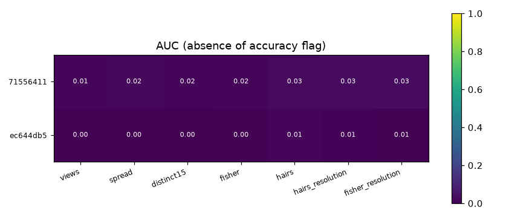
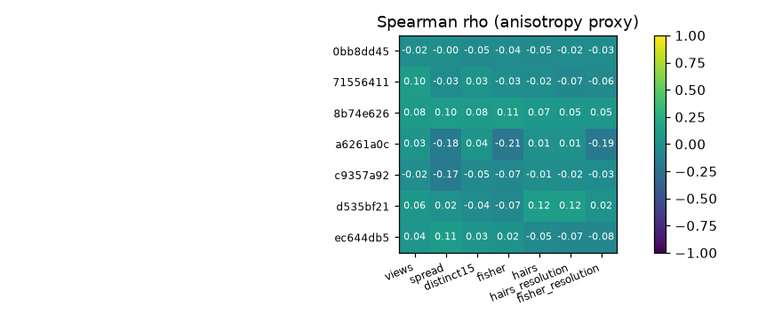

# Coverage hairs: what the available evidence can calibrate

2026-11-25. Offline research against the supplied artifact snapshot; no network, GPU,
Modal dispatch, production changes, or new training. The experiment is under
[`experiments/coverage_quality`](../../tools/pipeline/experiments/coverage_quality/).

**Finding:** angular diversity predicts our geometry gate better than repeated view
count, but the available independent signals do **not** identify a hair credit curve
or a views-to-fill threshold. Do not describe 14 hairs / 25° / 8 views as calibrated
splat quality. The tool below makes the missing photometric experiment runnable.

At 70° assumed FOV, c935's prototype hair score predicts majority-keep voxels with
AUC **0.845**, versus **0.926** for angular spread, on 1,000 occupied voxels
(167 majority-keep). That is a **circular outcome**. On the much smaller subset of
confidence cells without geometry-failure reasons, hair AUC for _absence of an
accuracy flag_ is **0.611** on Pumpkin (39 cells, 3 unflagged) and **0.208** on Spool
(14 cells, 2 unflagged). Even these unflagged cells are not certified photometric
passes: the public grid omits the held-out measurement denominator.

## 1. What our pipeline actually measures

These references describe today's source. Public job counters identify historical
versions, but missing private support columns prevent independently replaying each
historical tier assignment.

| Quantity             | Implementation and meaning                                                                                                                                                                                                               | Origin of constants                                                                                      |
| -------------------- | ---------------------------------------------------------------------------------------------------------------------------------------------------------------------------------------------------------------------------------------- | -------------------------------------------------------------------------------------------------------- |
| Observing views      | `tools/pipeline/quality.py:24`, `:30`: in-frame Gaussian centres passing an opaque-centre z-buffer, with depth tolerance and pixel-footprint allowance; not just nearby camera positions                                                 | Engineering approximation, not trained-quality calibration                                               |
| Spread               | `quality.py:31`: farthest-from-mean then farthest-from-that estimate of maximum pairwise view angle; lower bound, not exact all-pairs                                                                                                    | Computational approximation                                                                              |
| GSD                  | `quality.py:36`, `:39`: best visible `depth/focal`; relative to ROI median, absolute mm/px only when scale is known                                                                                                                      | Sampling geometry; relative cutoffs have no recorded measured origin                                     |
| Keep                 | `quality.py:244`, `:1075`: views ≥8, spread ≥45°, GSD ratio ≤2, alpha ≥0.02; optional absolute GSD ceiling                                                                                                                               | No recorded calibration of 8, 45, 2 or 0.02 found                                                        |
| Context              | `quality.py:247`, `:1101`: remaining points with views ≥3, spread ≥15°, GSD ratio ≤6, same alpha floor, within 2 ROI radii when ROI distances supplied                                                                                   | No recorded calibration of 3, 15, 6 or 2 found                                                           |
| Held-out demotion    | `quality.py:1699`, `:1751`: only coverage-keep can be demoted to context, if finite error has ≥2 pixels of blending weight and exceeds 2× median error of measured coverage-keep (fallback: all measured); optional absolute error limit | `quality.py:258`; relative policy, no recorded calibration                                               |
| Pixel error          | `holdout_maths.py:10`, `:51`, `:100`: `0.8 L1 + 0.2 (1−SSIM)`, RGB mean L1, 11-tap Gaussian SSIM window, sigma 1.5                                                                                                                       | gsplat trainer's loss settings; a loss convention, not an accuracy threshold                             |
| Gaussian attribution | `holdout_error.py:29`, `holdout_maths.py:18`: blending-weight attribution via a linear colour probe and backward pass                                                                                                                    | Renderer identity `weight = alpha × transmittance`; several Gaussians sharing a pixel share its error    |
| Rendering/SH         | `holdout_error.py:24`, `:238`: render shipped SH degree, record full-SH PSNR separately; classic/antialiased mode must match training                                                                                                    | Published appearance can differ from full training SH                                                    |
| `heldOutPsnr`        | `quality.py:1933`, `:1996`: rounded `train_metrics.json.psnr`; not a conversion from coverage; `training.py:803` clears validation metrics on all-frame runs                                                                             | Trainer's validation metric                                                                              |
| Split                | `training.py:283`, `:749`: `test_every=0` now defaults to all frames; historical v15 jobs used every eighth sorted image (`index % 8 == 0`) for validation                                                                               | gsplat split convention; **the old comment at `training.py:135` saying it is never overridden is stale** |
| `medianViews`        | `quality.py:1937`, `:2003`; `apps/api/app/worker/registration.py:467`: median geometric support in the pointed ROI, mapped to the catalog's `medianViews`                                                                                | A descriptive count, not a count of independent directions                                               |
| `keepPct`            | `quality.py:1422`, `:1988`: majority-keep share of occupied voxels near the supported extent, voxel size derived from GSD/support mask                                                                                                   | Not raw fraction of trained Gaussians, nor our fixed 0.1-unit research voxel statistic                   |
| Gate fallback        | `quality.py:1807`: strict → balanced → everything until at least min(1,000, total) Gaussians survive                                                                                                                                     | Availability policy; no quality guarantee                                                                |
| Confidence           | `confidence.py:11`, ADR 0016: alpha ≥0.05; `1+floor(254 × alpha-weighted keepShare × alignmentFactor)`; weak below 128. A reason requires >half the non-keep alpha to fail that criterion                                                | ADR explicitly says **first principles, not calibrated**                                                 |
| Surface              | `surface.py:84`, `:529`, `:750`; `tools/captures/cell_grid.py:37`: fewer than 3 samples is thin; DSM is second-highest sample, count stored as floor(log2 n) in support's high nibble                                                    | ADR 0018's uncalibrated estimators; not independent surveyed geometry                                    |

The requested **31° and 315° are observations, not thresholds**. The supplied
`site_0af85bb3-661f-4d79-b510-e33eee07a2d0.json` (d535) says highest elevation 31°,
315° missing azimuth, spread under 45°, and medianViews 942. The source rules are:

- `quality.py:1273–1297`: elevation bins below −10°, level −10–20°, raised 20–45°,
  above ≥45°. `from-above` fires with zero above views and <20% raised views;
  advice suggests a 45° elevated loop. No recorded calibration of those boundaries.
- `quality.py:1312–1328`: largest adjacent azimuth gap, rounded to a multiple of
  15°; `all-around` fires at rounded gap ≥60°. Thus 315° is this capture's gap.
- `quality.py:1334–1359`: `more-angles` fires if ≥15% of ROI Gaussians fail the
  keep spread cutoff, normally 45°; `more-frames` uses the analogous views failure.

c935's catalog medianViews is 250, median ROI spread 140.4°, missing azimuth 210°;
Pumpkin: 34, 81.7°, 75°; Spool: 100, 126.1°, 165°. These describe different ROI
populations than the research sample, which deliberately includes the weak fringe.

**Recorded context, not calibration:**
[ADR 0009](../DECISIONS/0009-view-cones.md) records canopy detail coarsening with
camera distance and Fort Clatsop's unseen-side problem, even with numerous views and
wide spread. Its packaging cones infer observer regions from detail; their metrics
are not held-out quality. [ADR 0016](../DECISIONS/0016-confidence-map.md) explains
confidence's majority rule and alignment cap. [ARCHIVE.md](../ARCHIVE.md),
`archive/bakeoff-fill-generative` and `archive/bakeoff-fill-v2`, records held-out
Spool-top experiments: plausible fills improved PSNR but did not recover the real
surface; solidity could improve while LPIPS worsened. Those are reasons to measure
appearance and geometry separately, not evidence for 8 views, 25° cones, or 45° spread.
No recorded origin for the prototype's 14 directions, 25° cone or sharpness was found
in those records. Eight total support views in the gate is **not** eight views per hair.

## 2. Physics and literature: hypotheses to measure

The references below are recalled from prior knowledge. **No links or bibliographic
details were checked online**, as requested. FisherRF/ActiveNeRF/FSGS identifiers
especially should be verified before using this as a publication bibliography;
no numerical benchmark claims below depend on recalling their tables.

- [Kerbl et al., 3D Gaussian Splatting (2023)](https://repo-sam.inria.fr/fungraph/3d-gaussian-splatting/):
  position, anisotropic covariance, opacity and SH appearance are jointly optimized.
  Repeated frames help noise/optimization but almost collinear bearings leave depth
  weakly constrained. Low opacity is not necessarily bad (foliage); high anisotropy
  can be a correct thin surface. These are diagnostic outcomes, not labels of truth.
- [FisherRF, active view selection using Fisher information](https://arxiv.org/abs/2311.17874)
  (2024, bibliographic details uncertain offline): information gain is parameter- and
  rendering-dependent, not simply a count of occupied angular bins. The bearing-only
  information matrix below is **not** FisherRF's trained-model Fisher matrix.
- [ActiveNeRF: Learning where to See with Uncertainty Estimation (2022)](https://arxiv.org/abs/2203.03864):
  uncertainty-directed acquisition motivates choosing views that constrain previously
  ambiguous regions, including visibility, rather than rewarding camera movement alone.
- [FSGS: Real-Time Few-shot View Synthesis using Gaussian Splatting](https://zehaozhu.github.io/FSGS/)
  (2024; recalled project URL): sparse-view 3DGS needs additional regularization and
  geometry constraints. Few-view degradation curves are scene/dataset dependent;
  there is no transferable “eight views is enough” curve for our MCMC/phone pipeline.
  A valid local curve requires training the **same scan** on nested view subsets.
- [Bayes' Rays, radiance-field uncertainty](https://bayesrays.github.io/)
  (2024, recalled attribution): spatial uncertainty and density support can reveal
  poorly constrained regions. Uncertainty inferred from a fitted scene still needs
  external validation; it does not make tier labels independent.
- [Hartley & Zisserman, Multiple View Geometry](https://www.robots.ox.ac.uk/~vgg/hzbook/):
  depth information depends on parallax, image noise and focal length. For two bearings
  at distance r, depth uncertainty scales roughly as `r σpixel/(f sin(parallax))` in
  a favorable two-view configuration. Very large angles also reduce common visibility
  and matching reliability. The often repeated **15–30° triangulation angle** and
  roughly **70–80% forward / 60–70% side overlap** are field heuristics recalled here,
  **not verified universal rules or calibrated thresholds**. Sweep parallax instead.

A smaller camera-to-surface distance reduces pixel footprint, but grazing incidence
undoes it: approximately `mm/px = 1000 r/(f |n·u|)`. Compare that footprint to the
requested surface detail or Gaussian axes projected into the view, not merely to
world-space distance. A tiny Gaussian below one pixel has weak shape evidence;
large Gaussians can fit blurry frames without recovering fine geometry. The public
sample lacks pre-gate scales, and nominal image width/FOV is not calibrated intrinsics.

Degree-d SH has `(d+1)^2` coefficients per colour channel (degree 3: 16); many frames
from one direction do not constrain all those angular variations. Full-SH and shipped
SH should be evaluated separately. Specularity, motion, blur and exposure changes
can create view-dependent residuals unrelated to geometric coverage. Occluded or
back-facing surfaces should receive no credit even when the camera is close.

Candidate per-surfel support, for hair h and observed view v:

```text
u_v = normalize(camera_v − surface_point)
a_vh = clamp((u_v·h − cos(cone))/(1 − cos(cone)), 0, 1)^sharpness
q_v  = min(1, (target_mm_px / mm_px_v)^2)       # a hypothesis, not a measured exponent
H_h  = min(1, sum_v visible_v × usable_v × a_vh × q_v / views_to_fill)
P    = min(1, max_parallax / parallax_gate)     # optional soft gate to fit
```

Keep directional hairs separate: their mean loses which side is missing. Smallest
eigenvalue or condition of `Σ(I−u uᵀ)/r²` can warn about depth degeneracy; the log
determinant can still look high after hundreds of almost identical bearings because
it gains information in two axes. Neither score alone measures a trained splat.

## 3. Observational experiment

Reproduce the numerical tables and three small PNGs from the worktree root:

```bash
mkdir -p .tmp
TMPDIR="$PWD/.tmp" MPLCONFIGDIR="$PWD/.tmp/mpl" \
OMP_NUM_THREADS=4 OPENBLAS_NUM_THREADS=4 MKL_NUM_THREADS=4 \
/home/harrison/hw-py/bin/python -I \
  tools/pipeline/experiments/coverage_quality/observe.py \
  --data-root /home/harrison/.cache/hex-coverage-research \
  --out docs/research/coverage-quality
# Delete .tmp after the run.
```

The input directory is only parsed. No downloaded code is imported or executed.
`summary.json` is the single summary table, including all FOV variants and LOJO
results. Fixed seed 2411, at most 1,000 samples per population, one GLB decoded at a
time; four compute threads. The final run took **63.83 s**, peaking at **183.0 MiB RSS**, including plots.
Runtime/peak RSS are recorded in that summary. Figures
are diagnostics, not additional data tables.

**Populations and visibility assumptions.** Read every tier-3 camera in capture
order. Use the median of **all** sampled Gaussian centres as an assumed pointing
centre (no tier labels used to aim cameras). Assume circular 70° total FOV, repeat
at 50° and 90°, no occlusion, no lens distortion, no back-face rejection. Estimate
focal from normalized image width and 70°; use width 1080 when unavailable. This
cannot reproduce real visibility. Changing FOV retains that nominal focal to isolate
visibility sensitivity. Camera poses/orientations and actual focal lengths are absent.
For Pumpkin/Spool, these camera sets include validation cameras: the artifact has no
image names to identify the sorted train split. Thus even their geometry predictors
have train/test leakage and are observational proxies only.

Bin the 150k-ish sampled centres into 0.1-unit 3-D voxels; sample occupied voxels
uniformly and use one centre per voxel for geometry, majority sample tier for the
label (ties count as keep). Sparse background voxels often have only one sampled
Gaussian; these are **not full-density voxel tiers**. PCA normal: 16 nearest sample
centres, face toward mean camera centre. At corners/foliage these are not reliable
surfel normals. Distances use published ENU units: **0.1 units is nominally 10 cm**;
several old records say scale unresolved. Their mm/px below is a nominal sensitivity
feature, not a measured physical resolution. c935 has ARKit scale evidence even
though the generic quality summary still reports GSD metric=false.

Use native confidence cells (0.25 m, Spool 0.5 m), with one geometry calculation per
cell, to avoid treating duplicated flags as independent Gaussians. Match sample
height by nearest centre in plan within one cell diagonal; report retained cells.
Sample cells before this height match, which can drop flagged cells. Surface outcome
is DSM present among cells with sample-source bits; absent includes thin and
out-of-range cells. Do not infer exact sample count from the logarithmic nibble.
Published shape/alpha outcomes sample uniformly over leaf Gaussian rows using random
priorities across **all** leaves; parents are excluded to avoid LOD duplication.

### Circularity quantified

| Job              | Training / validation frames | Trained Gaussians | Reported keepPct | Fraction of final tier unchanged by held-out error |
| ---------------- | ---------------------------: | ----------------: | ---------------: | -------------------------------------------------: |
| c9357a92         |                      724 / 0 |         5,626,152 |            59.7% |                                               100% |
| d535bf21         |                    1,060 / 0 |         3,760,398 |             0.5% |                                               100% |
| a6261a0c         |                      249 / 0 |           200,000 |             0.0% |                                               100% |
| 8b74e626         |                      137 / 0 |           200,000 |            94.6% |                                               100% |
| 0bb8dd45         |                    2,037 / 0 |        14,015,281 |            48.6% |                                               100% |
| 71556411 Pumpkin |                       49 / 7 |           711,907 |            69.1% |                                            98.170% |
| ec644db5 Spool   |                     156 / 23 |         1,388,939 |            69.2% |                                            99.437% |

The last column is the **structural fraction** `(total−demotedByHeldOut)/total`,
from job counters and the demotion-only code path; not a replay with missing inputs,
and not an estimate of “what fraction of AUC is circular.” That AUC decomposition
is not identifiable here. Pumpkin demotes 13,030/552,245 geometry-keep (2.359%);
Spool 7,815/986,270 (0.792%). Those cases alone add independent photometric evidence
to the tier. Geometry plus opacity/ROI rules explains every other tier by construction.
Accuracy attribution is independent of the geometry thresholds, but the **population
eligible to receive that label is selected by geometry**.

The premise “published means keep + context” also has exceptions: c935, d535 and
most other runs applied **strict**, publishing keep only. a626 applied **everything**
after the minimum-count fallback (1 keep, 2 context, 199,997 drop). Its 1,000 published
shape samples are therefore mostly dropped training Gaussians, not successful survivors.
50c25673 is ingest without cameras; 9e62fd60 lacks coverage/support. Both excluded.
No supplied API job/site record identifies a run as **beach**. 0bb8dd45 is included
as the Nov-03 capture, without assuming that missing identity.

### Candidate functions and geometry

Column abbreviations in every table:

- **V:** number of assumed observing views. **S:** exact maximum pairwise angular spread.
- **D:** greedy count of directions ≥15° apart, in capture order (not the optimal packing).
- **F:** `logdet(I + Σ(I−u uᵀ)/r²)`, a bearing-information proxy with identity prior.
- **H:** 14 equal-area Fibonacci directions on the PCA-normal hemisphere; 25° cone,
  sharpness **1** (the brief did not supply a sharpness value), sum credits, saturate
  at 8 per hair, average hairs. This instantiates the brief, not an exact iOS replay.
- **HR:** H with per-view `min(1,(2 nominal mm/px / footprint)^2)` credit weight.
- **FR:** `logdet(I + Σq(I−u uᵀ))`; footprint weighting replaces inverse-square range.

Absolute F's prior/scale and HR/FR's 2 mm target are hypotheses. They cannot be
transferred between unresolved-scale scenes as calibrated scores.

| Job     | Sample centres / cameras | Occupied sample voxels | Evaluated / majority-keep | Median V / S° / D | Min / median range† | Incidence cosine / best nominal mm/px |
| ------- | -----------------------: | ---------------------: | ------------------------: | ----------------- | ------------------- | ------------------------------------- |
| 0bb8    |          147,963 / 2,037 |                 67,363 |               1,000 / 396 | 722 / 30.18 / 2   | 14.10 / 18.42       | .31 / 36.11                           |
| Pumpkin |             149,944 / 56 |                  4,971 |               1,000 / 175 | 16 / 32.11 / 3    | 3.00 / 3.29         | .52 / 7.13                            |
| 8b74    |            149,863 / 137 |                  2,829 |               1,000 / 893 | 95 / 139.44 / 18  | 1.41 / 3.01         | .35 / 4.51                            |
| a626    |             64,716 / 249 |                     43 |                    43 / 0 | 249 / 1.70 / 1    | .40 / .41           | .80 / .65                             |
| c935    |            149,276 / 724 |                 14,631 |               1,000 / 167 | 162 / 17.94 / 2   | 3.19 / 3.47         | .50 / 6.91                            |
| d535    |          148,940 / 1,060 |                  1,795 |                 1,000 / 0 | 913 / 4.38 / 1    | 1.69 / 1.73         | .82 / 2.90                            |
| Spool   |            149,821 / 179 |                 19,002 |               1,000 / 156 | 63 / 21.73 / 2    | 6.49 / 6.92         | .39 / 11.60                           |

† Medians over points of their minimum and median ranges, in nominal ENU metres.
Median Fibonacci-hemisphere hit fraction at 25°: 0.143 for 0bb8/Pumpkin/c935/Spool,
0.429 for 8b74, 0.071 for a626/d535. Thousands of near-duplicate frames can fill one
hair while leaving the rest empty. These are measured under the stated assumptions,
not a reconstruction of the catalog's medianViews.

### AUC for majority-keep: circular

Higher scores predict keep. NA means only one class in the sampled voxel population;
we do not manufacture a rare-positive AUC or treat NA as 0.5.

| Job (n / keep)        |    V |    S |    D |    F |    H |   HR |   FR |
| --------------------- | ---: | ---: | ---: | ---: | ---: | ---: | ---: |
| 0bb8 (1,000 / 396)    | .782 | .883 | .844 | .892 | .799 | .833 | .845 |
| Pumpkin (1,000 / 175) | .983 | .984 | .994 | .995 | .960 | .950 | .952 |
| 8b74 (1,000 / 893)    | .816 | .798 | .814 | .806 | .787 | .808 | .815 |
| a626 (43 / 0)         |   NA |   NA |   NA |   NA |   NA |   NA |   NA |
| c935 (1,000 / 167)    | .834 | .926 | .901 | .915 | .845 | .864 | .876 |
| d535 (1,000 / 0)      |   NA |   NA |   NA |   NA |   NA |   NA |   NA |
| Spool (1,000 / 156)   | .988 | .990 | .992 | .992 | .968 | .962 | .969 |

Across the five defined jobs, mean AUC S=.916 (range .798–.990), F=.920
(.806–.995), H=.872 (.787–.968), HR=.883 (.808–.962). These **per-job spreads**
are the uncertainty description, not iid Gaussian bootstrap confidence intervals.
Nearby cells and the same camera path are strongly dependent; seven jobs, only two
with validation, cannot establish generalization intervals.


**Leave one job out:** fit a standardized linear probability model on the other six
jobs, with scaling learned only there. Held-job combined V/S/D/F/H/HR/FR AUC:
0bb8 **.881**, Pumpkin **.988**, 8b74 **.813**, c935 **.922**, Spool **.991**;
a626/d535 NA. Individual-feature LOJO results are also in `summary.json` (their
learned slopes retain the same sign, so their AUCs equal the fixed-score table).
No hyperparameter search on the held job. This tests transfer of our **gate proxy**,
not error prediction. There are too few measured positive/negative accuracy cells
to claim a credible independent LOJO calibration.

### Accuracy flags: independent residual, selected and incomplete labels

Native confidence grids contain 36 accuracy-flagged Pumpkin cells and 20 Spool
cells. Height matching after the bounded sample retains 557/36 and 925/12
cells/flags respectively. Zero flags on the five all-frame runs means **not measured**.
The grid sets an accuracy reason only when a majority of non-keep alpha is demoted;
an unflagged cell can be unmeasured, coverage-rejected, or a mixture of failures.

AUC predicting **absence** of that flag, without conditioning:

| Job (cells / unflagged) |    V |    S |    D |    F |    H |   HR |   FR |
| ----------------------- | ---: | ---: | ---: | ---: | ---: | ---: | ---: |
| Pumpkin (557 / 521)     | .015 | .022 | .016 | .016 | .025 | .028 | .028 |
| Spool (925 / 913)       | .004 | .004 | .003 | .004 | .015 | .009 | .007 |

These striking inversions are **selection effects**, not evidence that taking more
views harms quality: only geometry-keep can be demoted, so the central well-observed
cells can carry accuracy flags while the unmeasured fringe cannot.

Restrict to scored cells with **none of reason bits 1/2/4** (still not a verified-pass
mask; several failures can each be below a cell's majority threshold):

| Job (cells / unflagged) |    V |    S |    D |    F |    H |   HR |   FR |
| ----------------------- | ---: | ---: | ---: | ---: | ---: | ---: | ---: |
| Pumpkin (39 / 3)        | .542 | .667 | .634 | .667 | .611 | .657 | .611 |
| Spool (14 / 2)          | .312 | .333 | .250 | .292 | .208 | .333 | .250 |

Directions disagree between jobs and the effective denominator is tiny. No
photometric calibration, learned hair parameters, or causal claim follows.



### Shape and surface proxies

Spearman rho with **published alpha**, 1,000 leaf Gaussians per job:

| Job     |     V |     S |     D |     F |     H |    HR |    FR |
| ------- | ----: | ----: | ----: | ----: | ----: | ----: | ----: |
| 0bb8    | −.083 | −.137 | −.068 | −.068 | −.077 | −.094 | −.092 |
| Pumpkin | −.014 | −.175 | −.155 | −.163 | −.014 | −.020 | −.027 |
| 8b74    | −.133 | −.144 | −.142 | −.176 | −.117 | −.152 | −.157 |
| a626    |  .064 |  .130 |  .093 |  .118 |  .038 |  .040 |  .100 |
| c935    | −.047 | −.044 | −.037 | −.032 | −.051 | −.059 | −.048 |
| d535    | −.131 | −.149 | −.217 | −.052 | −.027 | −.027 | −.155 |
| Spool   | −.001 |  .065 |  .068 |  .060 |  .020 | −.031 | −.019 |

Spearman rho with **log(max scale/min scale)**, same samples:

| Job     |     V |     S |     D |     F |     H |    HR |    FR |
| ------- | ----: | ----: | ----: | ----: | ----: | ----: | ----: |
| 0bb8    | −.021 | −.003 | −.054 | −.036 | −.046 | −.025 | −.030 |
| Pumpkin |  .105 | −.031 |  .029 | −.028 | −.024 | −.069 | −.061 |
| 8b74    |  .080 |  .100 |  .083 |  .109 |  .067 |  .050 |  .053 |
| a626    |  .034 | −.179 |  .039 | −.206 |  .015 |  .012 | −.191 |
| c935    | −.019 | −.168 | −.050 | −.074 | −.012 | −.021 | −.030 |
| d535    |  .057 |  .015 | −.036 | −.071 |  .118 |  .118 |  .023 |
| Spool   |  .042 |  .108 |  .033 |  .018 | −.049 | −.072 | −.075 |

These weak, inconsistent associations do not validate a hair function. Gating
truncates the population, SPZ quantizes opacity/log-scales, and true planar surfaces
are anisotropic. Strict publication can hide exactly the malformed Gaussians of
interest; a626's fallback is a separate population. These are not circular tier
labels, but they are **selected, imperfect outcomes**, not ground-truth error.



AUC for **surface present**, native cells with sample-source bits:

| Job (n / surfaced)  |    V |    S |    D |    F |    H |   HR |   FR |
| ------------------- | ---: | ---: | ---: | ---: | ---: | ---: | ---: |
| 0bb8 (928 / 508)    | .717 | .842 | .808 | .865 | .742 | .786 | .807 |
| Pumpkin (424 / 361) | .794 | .793 | .753 | .838 | .775 | .778 | .770 |
| 8b74 (184 / 180)    | .803 | .879 | .854 | .881 | .782 | .810 | .804 |
| a626 (4 / 4)        |   NA |   NA |   NA |   NA |   NA |   NA |   NA |
| c935 (717 / 510)    | .693 | .748 | .652 | .762 | .617 | .665 | .687 |
| d535 (66 / 44)      | .439 | .805 | .511 | .838 | .458 | .488 | .645 |
| Spool (841 / 528)   | .682 | .748 | .704 | .794 | .622 | .696 | .723 |

Surface combines SfM and published alpha≥0.5 samples; it inherits publication
selection and density rules. It supports testing triangulation/distance features,
but is neither an independent measured surface nor a trained-render score.

**Visibility sensitivity:** H tier AUC at FOV 50° / 70° / 90°:
0bb8 .770/.799/.814; Pumpkin .965/.960/.903; 8b74 .747/.787/.789;
c935 .795/.845/.878; Spool .931/.968/.960. A c935 change of .083 across FOV
assumptions is material. Unconditioned accuracy-absence H AUC remains inverted:
Pumpkin .017/.025/.062, Spool .018/.015/.024. Real orientation/occlusion could
change all these results; FOV sensitivity does not bound that error.

## 4. Phone recommendation and recalibration loop

**Retain 14 normal-relative hemisphere hairs, 25° cone, linear cosine credit
(sharpness 1), fill 8 only as the explicit experimental baseline.** This is a
recommendation for the next experiment, not a measured quality threshold. There is
no evidence here to replace those numbers with another supposedly calibrated set.
The existing data supports separating angular novelty, resolution, and visibility;
it does not support saying a full hair means a good trained splat.

Use surfel normals where stable; world-relative directions would confuse a wall's
missing front view with a floor's missing overhead view. Store a stable tangent
frame; changing a PCA normal must not silently reinterpret accumulated hair bins.
Thin/two-sided vegetation may need a two-sided representation and should not be
forced into a single outward hemisphere. Keep “not observed” distinct from “observed
but trained badly.” Camera tracking and cell occupancy alone cannot infer occlusion.

For a practical 10 cm cell update, use live calibrated pose/intrinsics and depth
visibility; accumulate 14 dot products and scalar credits, best footprint, a few
representative directions and frame usability. Fourteen float accumulators cost
56 bytes per cell before metadata. At 10k cells this is ~0.56 MB for credits; updating
1k visible cells at 10 Hz is 140k hair dot products/s, an arithmetic estimate, **not a
phone benchmark**. Do not update every cell for every raw 60 fps frame. Select usable
keyframes with motion/parallax and time separation, record that sampling policy,
and recalibrate fill under that policy. Repeating 942 nearly identical frames must
not imply all-around coverage.

The footprint factor above (trial target 2 mm/px) and a 15–30° parallax sweep are
**unverified candidates**. For now show resolution/degeneracy as separate diagnostics;
do not quietly multiply them into production hairs or promise centimetre accuracy.
Normal reliability, blur thresholds, occlusion tolerances, SH degree and chosen live
keyframe cadence need measurement too. A cosine cone is a smooth angular kernel;
physics does not identify its cone width or power without held-out residual data.

After each real scan trains:

1. Preserve live per-cell credits, normal/frame, pose/intrinsics, keyframe IDs and
   usability, in a versioned coordinate frame with metric scale and algorithm version.
2. Join them to **pre-gate** trained surface patches, held-out L1/SSIM/LPIPS and
   measurement weight. Keep true zeros separate from missing measurements.
3. Fit on scans, split validation by scan/site/session and angular blocks, not random
   pixels. Test nearby every-eighth interpolation and genuinely novel elevated/side
   views separately. Include nested training subsets for view-count degradation.
4. Compare count-only, distinct-direction, parallax and hair kernels; report held-out
   R², calibration curves and false-full rates at a defined target error/detail.
   Bootstrap sites/scans/regions when enough exist. Freeze parameters only after
   leave-site-out performance and a live replay agree.
5. Version new parameters, re-evaluate old captures, and retain the measured error
   distribution behind “full.” Do not turn a fitted kernel into a probability of
   correctness without reliability calibration.

## 5. Calibration tool for the later GPU run

`calibration.py` implements the backend-independent path; `renderers.py` supplies
both `NumpyBackend` and lazy `GsplatBackend`; `gpu.py` loads the actual trainer
dataset/PLY and fits; `modal_job.py` is an **explicit later dispatch** CLI. No stage,
recipe, API or production publisher was registered or changed.

The Modal wrapper reuses `infra/modal/app.py`'s pinned gsplat **1.6.0 commit
512d366b**, torch/CUDA image and isolated `/opt/trainer` Python, plus
`modal_adapter.GPU_NAMES` and `GPU_RESERVATION`. It mounts an **existing private
research volume**, not production object storage. `cloud.StageRequest`/`remote.execute`
were inspected: their stage registration/output transfer is unnecessary for an
isolated experiment and would write pipeline artifacts. This tool uses the same
image/interpreter/reservation conventions without registering a new production stage.
Old holdout module prose still mentions 1.5.3; a current-image rerender is not proof
of byte-identical behavior to historical training. Record the actual trainer/image
commit, rasterization settings and SH degree in the run provenance.

Prepare privately: the exact assembled training `data_dir` (images, intrinsics,
undistortion/masks, sparse points/cameras), pre-gate trained PLY, verified metric
scale, and original split/settings. With an already valid held-out model, use
`--trained-test-every 8 --ply ...`. For c935, that would be dishonest: it trained
**all 724 frames**. Its only valid options are:

- **Fresh retrain with split:** `--trained-test-every 0 --retrain-with-split` trains
  from the same SfM initialization, no checkpoint resume, holding out 91 frames and
  training on 633. The tool builds argv with `training.gsplat_argv`, MCMC, cap
  5,626,152, 60k steps by default (30k base schedule scaled 2×), requested SH and rendering mode. It records argv,
  names and PLY hash. This is a controlled baseline, not automatic replay of every
  convergence/regularization option of the old run. Match the old settings before
  treating it as a bake-off. Shared SfM poses/initial points still use the full capture;
  validation is photometric holdout, not independent pose reconstruction.
- **Actually unused frames:** `--external-test-dataset` accepts separately registered
  leave-out frames in the **same metric frame**, rejects overlapping image names,
  and records the operator's provenance obligation. Renaming a training image does
  not make it independent. No such images are in this snapshot. Removing frames
  only from the evaluator of the original all-frame PLY does not undo training.

Example **for later execution, not executed in this research** (private research
volume must already contain the dataset; no public fetch command is provided):

```bash
cd tools/pipeline
python -m experiments.coverage_quality.modal_job --tier l40s -- \
  --dataset /research/c935/dataset --out /research/c935/calibration-split8 \
  --trainer /opt/gsplat/examples/simple_trainer.py \
  --trained-test-every 0 --retrain-with-split --metres-per-unit 1 \
  --test-every 8 --steps 60000 --cap 5626152 --sh-degree 3
```

Direct GPU-box equivalent runs `python -m experiments.coverage_quality.gpu` under
`GSPLAT_PYTHON`. Use `--antialiased`, `--unpacked`, `--data-factor` and SH degree to
match the model. Optimized camera poses/exposure/appearance modules must be exported
or baked consistently; raw COLMAP poses are insufficient if pose optimization ran.
`--frame-meta` accepts a parsed JSON `imageName -> {blur, exposure}` map; absent values
stay null. `--metres-per-unit` is required, so unresolved physical scale blocks a
claim about 10 cm patches and mm/px instead of silently assuming one metre.

The procedure is implemented as follows:

1. Render pre-gate PLY with lazy gsplat, true cameras, matching SH/classic-or-AA and
   packed setting, black background, RGB plus expected camera-z depth (`RGB+ED`).
   Match the trainer's RGB frame/mask via its `Parser`/`Dataset`, normalization off.
2. Render bounded 160-pixel training-camera depth maps for approximate visibility.
   Test depth reprojects to 0.1 m **3-D** patch IDs, with normals from depth gradients.
   Reject alpha≤0.5, masks and large depth-gradient/silhouette steps. Depth is alpha
   composited expected depth, not guaranteed physical surface; transparent layers
   and silhouettes remain limitations. Training visibility tolerance is max(5 cm,
   1% depth); this is a fixed research approximation, not calibrated occlusion.
3. Per test pixel compute RGB L1 and the repo's local SSIM; aggregate member pixels
   per patch, sample up to 256 patches per test frame. Score a 32×32 neighborhood
   centred on each patch using trainer-compatible AlexNet LPIPS from torchmetrics.
   LPIPS is a **neighborhood score** and can include neighboring surfaces; it is not
   falsely described as a per-pixel LPIPS attribution. Stream test RGBs one at a time.
4. From **training cameras only**, compute nearest test-to-training bearing angle,
   counts within 10/20/30°, best `1000 distance/(focal × |cos incidence|)` mm/px,
   exact maximum pairwise parallax, observing-view count, mean logged blur/exposure.
   Visibility uses the bounded depth maps; measurements use original focal lengths.
5. Fit L1, combined error and LPIPS separately: candidate cones 10/20/25/30/45/60°,
   powers .5/1/2/4, views-to-fill 1/2/4/8/16. Model error as
   `intercept + positive_slope × (1 − min(sum credit / fill, 1))`, hair centred on
   the **test direction**. Equal total weight per spatial patch, leave-test-view-out
   R², plus a simple nearest-angle regression. Optional best-footprint target
   1/2/4/8 mm/px and parallax soft gate 10/15/20/30° multiply effective views before
   saturation and are retained only for >.02 improvement in leave-view-out R².
   This patch-level best-footprint multiplier is not yet the per-view weighting
   proposed for live hairs; that transfer needs replay validation.
6. Write `patches.csv`, `fit.json`, `provenance.json`, and error-versus-angle,
   footprint and parallax plots. Fit reports in-sample and leave-view-out R² and
   grid-boundary warnings, or `no_monotone_fit`. Selecting the grid on those same
   folds is **exploratory CV**, not nested unbiased model assessment. Spatial/temporal
   dependence, count/fill/intercept confounding and narrow angular range can make
   parameters non-identifiable. A stride-8 split often leaves only near-neighbor
   test views; validate on withheld angular blocks and other scans before phone use.

The pure NumPy reference projects rotated anisotropic covariance through a pinhole
Jacobian and composites 2-D Gaussians front-to-back, returning RGB, alpha and expected
depth. It supports isotropic scales as a special case. It is intentionally a tiny
reference, not a claim of gsplat numerical equivalence: covariance floor, cutoffs,
sorting, SH and AA differ. CPU LPIPS remains **null**, not an L1 substitute.

`tests/test_coverage_calibration.py` generates 300 anisotropic Gaussians, five training
cameras, two test cameras and 64×48 images. Real image differences are planted as
`L1 = .01 + .002 × nearest_angle_degrees`; the complete render/depth/visibility/
patch/metric/fit/output path must recover the slope within .0003 and R²>.93 (hair fit
R²>.9). Other tests verify compositing/depth, anisotropic footprint and refusal to
call an all-frame model held-out. Only NumPy and pytest are needed locally; GPU,
plotting and Modal imports are lazy.

### GPU budget: rate evidence and explicit assumptions

From `tools/pipeline/providers.py:125–149` and
`modal_adapter.py:218–229`, **surveyed repo rates, not a current online quote**:

| Tier | GPU $/s | 2 CPU + 16 GiB $/s | Total $/s | Total $/h |
| ---- | ------: | -----------------: | --------: | --------: |
| L4   | .000222 |          .00006172 | .00028372 |  1.021392 |
| L40S | .000542 |          .00006172 | .00060372 |  2.173392 |

Reservation arithmetic: `2 × .0000131 + 16 × .00000222`. Usage above the reservation
is billed extra. Adapter prose mentioning 8 GiB is stale; use the constant, current
image and rate implementation. Source dates are 2026-09-23/27, as recorded there.

c935's job records 724 registered/trained frames, 5,626,152 Gaussians, 2,764,800
pixels per frame in `trainAdmission`, **3,666.55 s = 61.11 min** training on L40S
(60k steps), billed train container 3,956.43 s and $2.3886. Do not confuse whole job
7,230.99 s with training. 91 held-out frames = ceil(724/8); no new poses needed for
the photometric-split baseline. The recorded L40S/L4 speed ratio ~2.3 in
`modal_adapter.py:166` is an estimate from another benchmark, not measured for this scan.

| Later job                                                            | L40S minutes / dollars | L4 minutes / dollars     |
| -------------------------------------------------------------------- | ---------------------- | ------------------------ |
| Render/evaluate only, already valid split or genuinely unused frames | 5–15 / **$0.18–0.54**  | 8–25 / **$0.14–0.43**    |
| Fresh split retrain plus evaluation                                  | 66–96 / **$2.39–3.48** | 149–212 / **$2.54–3.61** |

Render/evaluate assumptions: 91 native-resolution test RGB+depth renders, 633 small
training depth renders (724 for an external-test all-frame model), ≤23,296 LPIPS
neighborhoods, feature extraction/fits and warm input load. Native renders assumed
roughly 0.2–1 s/frame on L40S, small-depth renders 0.02–0.10 s, with most remaining
budget in LPIPS/CPU features and data loading. **These throughputs are unmeasured.**
The range is a planning allowance, not a benchmark; slow storage or single-patch
LPIPS calls can exceed it. First run a bounded `--max-test-frames 8 --max-patches 64`
rehearsal and price its measured phases before the full batch.

Retrain assumes L40S 61–81 min (observed 61.11 plus margin); L4 141–187 min using
~2.3× multiplier, then adds evaluation above. Keeping 60k optimization steps means
holding out 1/8 does **not** automatically save 1/8 of training cost. L4 fits the
recorded admission cap but is near its resolution-dependent ceiling; L40S is the
more practical capacity choice. These costs exclude image rebuild, queue delay,
volume/storage charges, new SfM, transfer outside the allowance, and idle scale-down
(up to another minute per container). A matching-image retrain, settings audit and
an actual timing rehearsal remain required. **No GPU expenditure occurred here.**

## 6. Exact missing artifacts and the smallest useful export

| Missing artifact                                                                                                                  | Analysis it blocks                                                                                                                       | Proposed later pipeline/publish change (not implemented here)                                                                                                 |
| --------------------------------------------------------------------------------------------------------------------------------- | ---------------------------------------------------------------------------------------------------------------------------------------- | ------------------------------------------------------------------------------------------------------------------------------------------------------------- |
| `pose/poses/{cameras.bin,images.bin}` or equivalent ARKit cameras with image IDs, intrinsics/distortion, R/t and frame convention | True frustum visibility, real focal/GSD, training-only view directions, exact parallax and split identity                                | Publish a decimated camera JSON/NPZ with full orientation/intrinsics, image names, capture order and train/val role, plus original-to-render image transforms |
| Verified metric similarity / `placement.json` / exact `georef.json`                                                               | Physical 10 cm patches, normals and rays in the same frame, real mm/px; several old sites have unresolved scale                          | Export the similarity, scale provenance and uncertainty with cameras and sample; c935 ARKit evidence should be preserved explicitly                           |
| Pre-gate `train/trained.ply`, including dropped opacity/scales/quaternions/SH                                                     | Unselected shape/opacity analysis, real rasterization and depth/error attribution; published leaf rows cannot reconstruct dropped splats | Keep the private full PLY for calibration; publish a deterministic decimated **pre-gate** sample retaining shape/SH/tier and stable original row IDs          |
| `quality/support/` views/spread/GSD/reasons/alpha/tier, including dropped rows                                                    | Exact rule replay, exact geometric visibility comparison, disagreement decomposition and pre-gate matched correlations                   | Publish a ≤100k-row sample keyed to those same row IDs and placement, not separately randomized centres                                                       |
| `quality.json` with thresholds, pointed ROI, support-mask provenance, raw support summaries and held-out report                   | Historical threshold overrides, true camera pointing target, GSD normalizer and support-mask selection                                   | Publish a scrubbed research descriptor, including recipe/code hashes; current registration summary drops these details                                        |
| `train/holdout/{holdout_error.npy,holdout_weight.npy,holdout_views.npy,holdout.json}` and per-cell measured denominator           | Continuous independent outcomes; distinguish an unmeasured zero accuracy bit from verified low error; robust conditional AUC/LOJO        | Export sampled continuous residual/weight/measurement flags and cell sums; leave “not measured” explicit                                                      |
| Actual undistorted training/held-out RGB frames, masks and split manifest                                                         | Render-versus-photo L1/SSIM/LPIPS, blur/exposure measures, valid new splits                                                              | Private calibration bundle/volume with exact image hashes, names, masks, split and resized intrinsics; do not publish personal imagery by default             |
| Learned camera/exposure/appearance corrections, train configuration and renderer/image commit                                     | Matching optimized poses, SH, AA and baked colour; replaying old training accurately                                                     | Preserve effective cameras and exported appearance settings with the private bundle                                                                           |
| Per-frame blur/exposure/timestamps and live per-cell/keyframe log                                                                 | Distinguishing repeated blurry frames from useful observations; mapping fitted fill to phone cadence                                     | Export parsed frame metadata plus live coverage accumulator/version in the same metric frame                                                                  |

Camera centres alone cannot supply orientation, opacity alone cannot supply error,
and the absence of an accuracy bit cannot supply its missing denominator. Those are
the specific limits preventing a measured phone-quality claim today.

## Verification

The requested offline uv invocation failed before resolving a venv: it could not
create its cache lock under read-only `/home/harrison/.cache/uv`. The authorized
fallback was used from this worktree's `tools/pipeline`, with `TMPDIR` inside the
worktree `.tmp` and four-thread environment limits:

```bash
/home/harrison/Documents/Projects/Hexapod/tools/pipeline/.venv/bin/ruff check \
  experiments/coverage_quality tests/test_coverage_calibration.py
/home/harrison/Documents/Projects/Hexapod/tools/pipeline/.venv/bin/ruff format --check \
  experiments/coverage_quality tests/test_coverage_calibration.py
/home/harrison/Documents/Projects/Hexapod/tools/pipeline/.venv/bin/python -m pytest -q \
  tests/test_coverage_calibration.py
/home/harrison/Documents/Projects/Hexapod/tools/pipeline/.venv/bin/mypy \
  experiments/coverage_quality tests/test_coverage_calibration.py
```

Final fallback gate tail after the implementation edits:

```text
All checks passed!
8 files already formatted
4 passed
Success: no issues found in 8 source files
```

The Python gate was run after the final report edit as well. Temporary files were removed.
GPU image construction,
CUDA rendering, original trainer reproduction and the real-data fit remain unexecuted.
