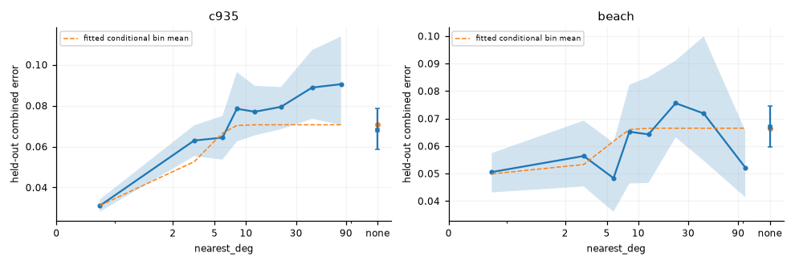
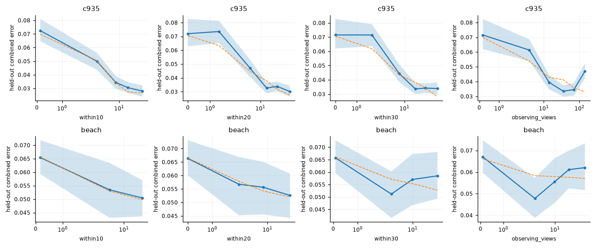
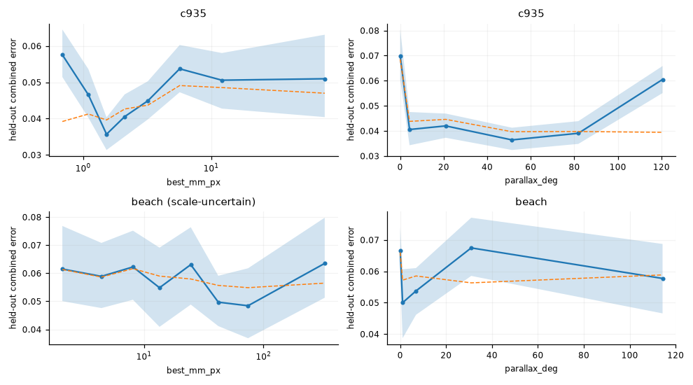
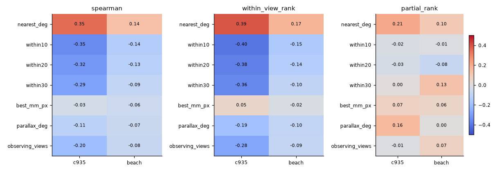
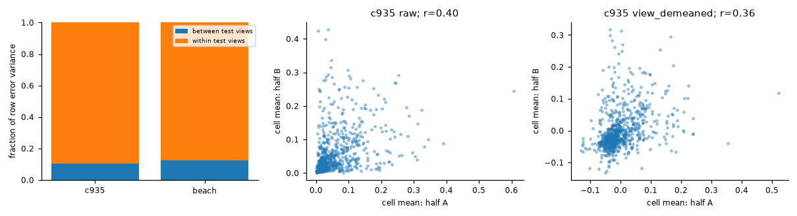
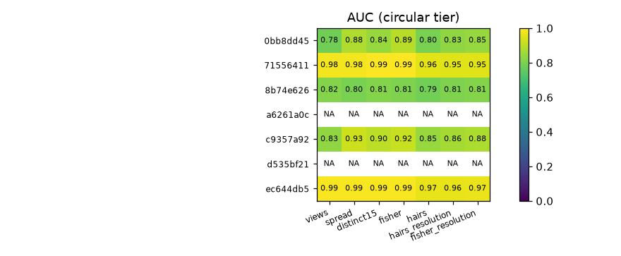

# Coverage hairs: measured held-out splat quality

2026-11-25 campaign, with completed GPU results supplied by the worker. Harrison
approved the run and the **$5 cap through the coordinator**. The coordinator/worker
dispatched Modal; this write-up used CPU only, no network and no Modal calls.

**Finding:** directional support predicts a small part of held-out rendering error,
not a reliable probability that a trained splat is good. The best tested kernel is
**10° cone, power 4**, with **four effective views for c935 and two for Beach**.
Leave-test-view-out R² is **0.079 indoor** and **0.011 outdoor**. Both kernel
parameters hit grid boundaries; transfer to Beach is **R² −0.016**. The data favor
having a training bearing very close to the requested viewing direction, roughly
within 5–10°, rather than the prototype's broad 25° cone. They do not validate one
universal fill threshold, 14 directions, eight views per hair, or a “quality full”
claim. The older high keep/drop AUCs mostly reproduce our own geometry rules.

## 1. Completed GPU experiment: the main evidence

The target is measured photometric error on frames excluded from training:

```text
error = 0.8 × RGB L1 + 0.2 × (1 − SSIM)
credit(t) = clamp((cos(t) − cos(cone)) / (1 − cos(cone)), 0, 1)^sharpness
support = min(1, sum_training_views credit(t) / views_to_fill)
predicted_error = scene_intercept + positive_slope × (1 − support)
```

Here `t` is the bearing angle between a test view and an observing **training**
camera at the patch. “Fill” means equivalent perfectly aligned views, not any
views inside the cone. Credit at 5° is about **0.316** and at 7° about **0.067**;
half credit occurs near 4°. Thus four effective views can require ~13 frames at 5°.
This is a continuous error regression, not an accuracy classifier or reliability
calibration. No keep/context/drop labels enter these fits.

### Models, split, and provenance

| Scene                     | Training camera names | Test views | Patch/view rows |       Unique 3-D cells | Gaussians | Measured main wall time      |
| ------------------------- | --------------------: | ---------: | --------------: | ---------------------: | --------: | ---------------------------- |
| c935 indoor tabletop      |                   633 |         91 |           5,387 |                  4,382 | 5,626,152 | 5,226.97 s = 87.12 min, L40S |
| Beach outdoor walk-around |                 1,818 |         38 |           1,310 |                  1,310 | 7,247,091 | 163.22 s, L4                 |
| Pooled                    |                     — |        129 |           6,697 | 5,692, scene-qualified |         — | Local fit                    |

c935 was freshly retrained with every eighth sorted frame withheld, starting at
index zero: 633 train / 91 test from 724. The reduced pool uses `test_every=0`,
so there is no second validation split. It used the pinned v17 60k-step MCMC
schedule, SfM initialization, opacity regularization .002, cap 5,626,152, SH 3,
native resolution, classic/packed rendering, and no pose/appearance optimization.
The earlier public c935 job trained on all frames; its training PSNR was not used
as independent validation. Poses still come from the original joint solve/ARKit
source, so this is photometric holdout, not an independent pose reconstruction.

Beach reuses trained run `4769ee65e33c44f2aacd87a45dfa3811`; no Beach retraining
was charged. Its saved provenance lists **1,818 training names plus 38 test names**,
not 1,818 total images. It used SH 3 and classic rendering, matching the model.
Actual train/test names, hashes, renderer, code/image identity and scale evidence
are preserved in the copied provenance, rather than inferred from frame counts.

- **c935 scale:** 1.0 m/unit, `ARKit metric poses (job c9357a92 georeference
scaleSource=arkit, scale 1.0)`. This names pipeline evidence, not a personal
  verification by Harrison.
- **Beach scale:** **2.232937 m/unit**, `camera-height estimate from production job
4dd02171 georeference (unverified, not ARKit)`. `beach-full` was frozen from
  `runs/4dd02171-341d-4970-bad2-8e410fb8d233`, capture `00113695`, also the capture
  behind job `0bb8dd45`. **Physical patch sizes and mm/px remain scale-uncertain**.
  The old scale-1 Beach rehearsal proves plumbing, not physical calibration.

RGB, expected camera-z depth and alpha use the trainer-compatible gsplat settings.
Test depth projects pixels onto nominal 0.1 m cells, with at most 64 patches per
view. L1/SSIM use actual cell-member pixels; LPIPS uses a 32×32 neighborhood and
can include adjacent surfaces. Normals come from test-depth gradients. Training
visibility uses cached 160 px depth maps, alpha >.5 and tolerance max(5 cm, 1% depth).
It is approximate on thin, transparent, occluded or layered surfaces. Only training
cameras supply angles, counts, parallax and incidence-adjusted best mm/px.

### Fitted prototype functions

| Fit, combined error           | Cone | Sharpness | Views-to-fill | mm/px target | Parallax gate |      R² | LOVO R² |     LOSO R² on this scene |
| ----------------------------- | ---: | --------: | ------------: | ------------ | ------------- | ------: | ------: | ------------------------: |
| c935                          |  10° |         4 |             4 | Not retained | Not retained  | .083284 | .079246 | .049341, trained on Beach |
| Beach                         |  10° |         4 |             2 | Not retained | Not retained  | .020475 | .011057 | −.015988, trained on c935 |
| Pooled, scene intercepts only |  10° |         4 |             4 | Not retained | Not retained  | .074814 | .070501 |         .044163 aggregate |

LOVO = leave one test view out. LOSO = leave one scene out, retuning all kernel
parameters on the other scene, **without adapting the held scene's intercept**.
The aggregate transfer score is row-weighted and dominated by c935; it does not
rescue negative transfer to Beach. The pooled R² includes scene intercepts and
must not all be attributed to geometry: the intercept-only baseline is **.002382**,
versus .074814 with directional support, using the fitter's cell-balanced parameter
weights and the same row-level R² definition.

The original grid was cones 10/20/25/30/45/60°, powers .5/1/2/4, fills 1/2/4/8/16.
Optional resolution targets 1/2/4/8 mm/px and parallax gates 10/15/20/30° were kept
only for >.02 absolute LOVO R² gain. **Neither was retained**; this means no support
under this grid/selection rule, not proof that resolution or triangulation is
irrelevant. Hyperparameters were selected on the same LOVO folds reported, so
these are exploratory, optimistically selected scores, not nested-CV estimates.
Regression parameters give each spatial cell total weight one across repeated
views; reported R²/LOVO scores use unweighted row errors. Curve means and the
variance decomposition also use rows, not pixel weights.

The fitted error models are:

```text
c935:  error_hat = .026168 + .044470 × (1 − support_fill4)
Beach: error_hat = .048947 + .017530 × (1 − support_fill2)
Pooled: intercept_Beach = .030687; intercept_c935 = .028822
        error_hat = intercept_scene + .040035 × (1 − support_fill4)
```

The common narrow kernel transfers qualitatively, but fill 2 versus 4 and different
error slopes/intercepts do not establish a shared quantitative function.
Alternative targets also disagree:

| Target | c935 fill / LOVO R² | Beach fill / LOVO R² | Pooled fill / LOVO R² | Aggregate LOSO R² |
| ------ | ------------------- | -------------------- | --------------------- | ----------------: |
| L1     | 4 / .060021         | 4 / .007342          | 4 / .052980           |           .033852 |
| LPIPS  | 4 / .053532         | 16 / −.001854        | 4 / .046938           |          −.011140 |

All those fits also chose cone 10° / power 4. Beach's perceptual fit does not beat
its held-out-view mean baseline. Eight views per hair has no measured support here.

### Near-angle curves and rank diagnostics

Blue curves are patch-row means with **95% percentile bootstrap intervals from
1,000 resamples of whole test views**, seed 2411. Bins are disjoint; counts and
contributing views are in `diagnostics.json`. Orange curves are the original fitted
model's conditional bin means, not causal one-feature effects. Intervals condition
on these two trained scenes; neighboring test views remain temporally correlated,
so they are not confidence intervals for new scans or environments.



On c935, mean error rises from **.0310 [.0281, .0341]** within 0–2° (2,380 rows /
91 views) to **.0630 [.0553, .0704]** at 2–5° (438 / 89), and **.0785 [.0625, .0964]**
at 7–10° (149 / 61). Beach is weaker: **.0505 [.0431, .0574]** at 0–2° (271 / 38),
**.0564 [.0453, .0692]** at 2–5° (103 / 34), with overlapping, non-monotonic bins.
This supports local view familiarity, most clearly indoors, not a sharp universal
10° quality cutoff.

The `none` category is separate from real angles: **1,554/5,387 c935 rows (28.8%)**
and **581/1,310 Beach rows (44.4%)** have no training view passing the approximate
depth test; nearest_deg=180 is a sentinel. Their mean errors are .0681 and .0670.
They are not measured 180° bearings or proof of zero true visibility. Best mm/px
is missing there, so partial-rank analyses below cover a selected observed subset.

| Feature         | c935 Spearman | c935 within-view rank | c935 partial rank | Beach Spearman | Beach within-view rank | Beach partial rank |
| --------------- | ------------: | --------------------: | ----------------: | -------------: | ---------------------: | -----------------: |
| nearest_deg     |        +0.351 |                +0.394 |            +0.210 |         +0.137 |                 +0.174 |             +0.105 |
| within10        |        -0.351 |                -0.402 |            -0.022 |         -0.139 |                 -0.154 |             -0.009 |
| within20        |        -0.315 |                -0.378 |            -0.028 |         -0.125 |                 -0.136 |             -0.076 |
| within30        |        -0.286 |                -0.356 |            +0.004 |         -0.091 |                 -0.101 |             +0.130 |
| best_mm_px      |        -0.031 |                +0.054 |            +0.073 |         -0.060 |                 -0.022 |             +0.056 |
| parallax_deg    |        -0.113 |                -0.186 |            +0.159 |         -0.067 |                 -0.097 |             +0.001 |
| observing_views |        -0.199 |                -0.275 |            -0.011 |         -0.075 |                 -0.086 |             +0.070 |

Partial ranks residualize feature/error ranks on **all other geometry ranks,
pixel-count rank and test-view fixed effects** using within-view demeaning.
Complete cases: **3,833 c935 / 729 Beach rows**; raw Spearman is pairwise-complete
(5,387/1,310 except mm/px). Counts are strongly related, so partial signs are
conditional associations, not feature importance or causal effects. Nearest-angle
Spearman on observing-only rows is **.432 c935 / .106 Beach**.







The weak/inconsistent mm/px and parallax associations do not justify fitted hair
multipliers. Incidence, depth-based visibility, correlated camera paths and uncertain
Beach scale limit interpretation. Physics-based acquisition advice can remain
separate from this weak rendering-error predictor.

### Why the R² is low, and what noise ceiling is measurable

| Diagnostic                                                        |            c935 |           Beach |
| ----------------------------------------------------------------- | --------------: | --------------: |
| Between-test-view share of error sum of squares                   |          10.25% |          12.49% |
| Within-test-view share                                            |          89.75% |          87.51% |
| Mean / median error                                               | .05349 / .02595 | .06187 / .04638 |
| Highest-error 1% of rows: share of squared deviation              |          27.95% |          15.34% |
| Repeated 10 cm cells / rows in those cells                        |     797 / 1,802 |           0 / 0 |
| Raw repeated-cell split-half Pearson, median over 200 allocations |            .399 |   Not estimable |
| Same, after removing test-view means                              |            .362 |   Not estimable |
| Exchangeable-repeat ICC: raw / view-demeaned                      |     .363 / .328 |   Not estimable |

The variance split is an exact descriptive ANOVA over **unweighted row errors**.
Most variation is local within a view, and large-error tails strongly affect squared
loss; a moderate rank trend need not give a large R². Texture, view-dependent color,
pose/registration error, disocclusion, blur/exposure and imperfect depth attribution
are plausible contributors, but their variance shares were not measured. The
unexplained 92–99% is **not** an estimate of pure noise.



For c935, split each repeated cell's observations randomly between two halves and
correlate cell-mean errors. The 2.5–97.5% **allocation ranges**, not population CIs,
are .382–.413 raw and .343–.379 after view demeaning. An unbalanced one-way random
intercept calculation gives ICC .363/.328. **If** different-view measurements were
exchangeable noisy replicas of one fixed cell error, those ICCs would suggest an
approximate .36/.33 single-row ceiling for a cell-stable predictor on this repeated
subset. That assumption is unverified: view direction changes the target itself,
and depth-projected grid cells can mix different surfaces. This is repeat-cell
consistency, not an identified photometric-noise ceiling. Beach has no repeats.
There are no repeated renders/photos at fixed patch **and view**, nor per-patch
pixel error variances, so a defensible pure-noise ceiling remains unmeasured.

### Boundary extension: blocked by the saved angle export

The requested CPU extension is cones **3/5/7/10°**, powers **4/8/16**. The analysis
implements and tests exact refitting when raw angles are present. In these actual
CSVs, **every `angles_deg` list is empty**, despite positive observing-view counts.
The exporter retained exact sums for the original 24 kernels plus six cone counts,
then discarded raw angles. These sufficient statistics reproduce the original grid
fits, which the analysis verifies, but do not identify smaller cones or higher
moments. Squaring a sum of fourth-power credits does not yield a sum of eighth powers.
Nearest angle alone cannot reconstruct all observing directions. Therefore we
**cannot tell whether the optimum continues beyond the boundary from these files**;
no surrogate extension is reported as a refit.

## 2. Phone recommendation and the next calibration step

1. **Use the narrow signal provisionally:** `cone=10°`, `sharpness=4`, `fill=4`
   effective training-eligible views, as directional support rather than predicted
   correctness. Beach's fill=2 is evidence against universal fill, not a reason to
   announce two frames sufficient. Match the eventual training keyframe sampler;
   counting 60 Hz preview frames would change the denominator and invalidate fill.
2. **Increase internal angular resolution; keep the UI sparse.** A 14-direction
   hemisphere with 10° caps covers only **20.5%** of 10,000 equal-area probe bearings.
   A provisional **128 normal-relative bins** covers 99.63% (sampled worst gap 11.74°);
   256 covers all probes (worst gap 7.60°). These are discretization calculations,
   not fitted quality-optimal hair counts or rigorous covering bounds. Start with
   128 internal targets and sparse displayed sector summaries; test 256 and horizon
   padding for missed directions and steep-kernel interpolation bias. Fourteen
   independent 10° hairs cannot represent hemisphere coverage.
3. **Use visibility and stable local normals.** Keep direction state normal-relative;
   lock or rebin when normals change. Update only visible cells and usable keyframes.
   128 half-precision capped accumulators cost 256 bytes/cell, ~2.56 MB per 10,000
   cells, plus metadata; dot products can be vectorized. This is a budget estimate,
   not an iPhone performance measurement. No iOS/app code is changed here.
4. **Drop fitted distance/footprint weighting and the parallax multiplier for now.**
   Neither passed the predeclared LOVO gain rule. Keep distance, baseline and weak
   tracking as separate acquisition guidance; the gate's geometry requirements and
   physical triangulation remain relevant to shape, which this loss does not measure.
5. **Recalibrate across scans.** Retain per-patch raw angles/observing-view IDs and
   sampling policy; rerun evaluation of retained models to extend the boundary grid
   without retraining them. Then add multiple indoor/outdoor scans, fit on scans
   rather than neighboring views, hold whole scans out, and compare the logged live
   cell state to trained held-out residuals. Train nested view subsets of the same
   scans to identify count saturation causally. Survey Beach scale; measure actual
   geometric fidelity and fixed-patch/fixed-view repeat noise before a quality claim.

One function does **not** yet hold quantitatively across indoor tabletop and outdoor
walk-around: the shared narrow kernel is a hypothesis, while fill, error amplitude,
perceptual behavior and transfer differ. Do not derive a probability of correctness
from hair fullness, or silently replace the production gate with these parameters.

## 3. Pipeline ground truth and the geometry gate

These references describe today's source. Public job counters identify historical
versions, but missing private support columns prevent independently replaying each
historical tier assignment.

| Quantity             | Implementation and meaning                                                                                                                                                                                                               | Origin of constants                                                                                      |
| -------------------- | ---------------------------------------------------------------------------------------------------------------------------------------------------------------------------------------------------------------------------------------- | -------------------------------------------------------------------------------------------------------- |
| Observing views      | `tools/pipeline/quality.py:24`, `:30`: in-frame Gaussian centres passing an opaque-centre z-buffer, with depth tolerance and pixel-footprint allowance; not just nearby camera positions                                                 | Engineering approximation, not trained-quality calibration                                               |
| Spread               | `quality.py:31`: farthest-from-mean then farthest-from-that estimate of maximum pairwise view angle; lower bound, not exact all-pairs                                                                                                    | Computational approximation                                                                              |
| GSD                  | `quality.py:36`, `:39`: best visible `depth/focal`; relative to ROI median, absolute mm/px only when scale is known                                                                                                                      | Sampling geometry; relative cutoffs have no recorded measured origin                                     |
| Keep                 | `quality.py:244`, `:1075`: views ≥8, spread ≥45°, GSD ratio ≤2, alpha ≥0.02; optional absolute GSD ceiling                                                                                                                               | No recorded calibration of 8, 45, 2 or 0.02 found                                                        |
| Context              | `quality.py:247`, `:1101`: remaining points with views ≥3, spread ≥15°, GSD ratio ≤6, same alpha floor, within 2 ROI radii when ROI distances supplied                                                                                   | No recorded calibration of 3, 15, 6 or 2 found                                                           |
| Held-out demotion    | `quality.py:1699`, `:1751`: only coverage-keep can be demoted to context, if finite error has ≥2 pixels of blending weight and exceeds 2× median error of measured coverage-keep (fallback: all measured); optional absolute error limit | `quality.py:258`; relative policy, no recorded calibration                                               |
| Pixel error          | `holdout_maths.py:10`, `:51`, `:100`: `0.8 L1 + 0.2 (1−SSIM)`, RGB mean L1, 11-tap Gaussian SSIM window, sigma 1.5                                                                                                                       | gsplat trainer's loss settings; a loss convention, not an accuracy threshold                             |
| Gaussian attribution | `holdout_error.py:29`, `holdout_maths.py:18`: blending-weight attribution via a linear colour probe and backward pass                                                                                                                    | Renderer identity `weight = alpha × transmittance`; several Gaussians sharing a pixel share its error    |
| Rendering/SH         | `holdout_error.py:24`, `:238`: render shipped SH degree, record full-SH PSNR separately; classic/antialiased mode must match training                                                                                                    | Published appearance can differ from full training SH                                                    |
| `heldOutPsnr`        | `quality.py:1933`, `:1996`: rounded `train_metrics.json.psnr`; not a conversion from coverage; `training.py:803` clears validation metrics on all-frame runs                                                                             | Trainer's validation metric                                                                              |
| Split                | `training.py:283`, `:749`: `test_every=0` now defaults to all frames; historical v15 jobs used every eighth sorted image (`index % 8 == 0`) for validation                                                                               | gsplat split convention; **the old comment at `training.py:135` saying it is never overridden is stale** |
| `medianViews`        | `quality.py:1937`, `:2003`; `apps/api/app/worker/registration.py:467`: median geometric support in the pointed ROI, mapped to the catalog's `medianViews`                                                                                | A descriptive count, not a count of independent directions                                               |
| `keepPct`            | `quality.py:1422`, `:1988`: majority-keep share of occupied voxels near the supported extent, voxel size derived from GSD/support mask                                                                                                   | Not raw fraction of trained Gaussians, nor our fixed 0.1-unit research voxel statistic                   |
| Gate fallback        | `quality.py:1807`: strict → balanced → everything until at least min(1,000, total) Gaussians survive                                                                                                                                     | Availability policy; no quality guarantee                                                                |
| Confidence           | `confidence.py:11`, ADR 0016: alpha ≥0.05; `1+floor(254 × alpha-weighted keepShare × alignmentFactor)`; weak below 128. A reason requires >half the non-keep alpha to fail that criterion                                                | ADR explicitly says **first principles, not calibrated**                                                 |
| Surface              | `surface.py:84`, `:529`, `:750`; `tools/captures/cell_grid.py:37`: fewer than 3 samples is thin; DSM is second-highest sample, count stored as floor(log2 n) in support's high nibble                                                    | ADR 0018's uncalibrated estimators; not independent surveyed geometry                                    |

The requested **31° and 315° are observations, not thresholds**. The supplied
`site_0af85bb3-661f-4d79-b510-e33eee07a2d0.json` (d535) says highest elevation 31°,
315° missing azimuth, spread under 45°, and medianViews 942. The source rules are:

- `quality.py:1273–1297`: elevation bins below −10°, level −10–20°, raised 20–45°,
  above ≥45°. `from-above` fires with zero above views and <20% raised views;
  advice suggests a 45° elevated loop. No recorded calibration of those boundaries.
- `quality.py:1312–1328`: largest adjacent azimuth gap, rounded to a multiple of
  15°; `all-around` fires at rounded gap ≥60°. Thus 315° is this capture's gap.
- `quality.py:1334–1359`: `more-angles` fires if ≥15% of ROI Gaussians fail the
  keep spread cutoff, normally 45°; `more-frames` uses the analogous views failure.

c935's catalog medianViews is 250, median ROI spread 140.4°, missing azimuth 210°;
Pumpkin: 34, 81.7°, 75°; Spool: 100, 126.1°, 165°. These describe different ROI
populations than the research sample, which deliberately includes the weak fringe.

**Recorded context, not calibration:**
[ADR 0009](../DECISIONS/0009-view-cones.md) records canopy detail coarsening with
camera distance and Fort Clatsop's unseen-side problem, even with numerous views and
wide spread. Its packaging cones infer observer regions from detail; their metrics
are not held-out quality. [ADR 0016](../DECISIONS/0016-confidence-map.md) explains
confidence's majority rule and alignment cap. [ARCHIVE.md](../ARCHIVE.md),
`archive/bakeoff-fill-generative` and `archive/bakeoff-fill-v2`, records held-out
Spool-top experiments: plausible fills improved PSNR but did not recover the real
surface; solidity could improve while LPIPS worsened. Those are reasons to measure
appearance and geometry separately, not evidence for 8 views, 25° cones, or 45° spread.
No recorded origin for the prototype's 14 directions, 25° cone or sharpness was found
in those records. Eight total support views in the gate is **not** eight views per hair.

## 4. Combining the original no-GPU observations

The original sampled-public-artifact analysis remains reproducible by `observe.py`;
its numerical tables and proxy associations are in
[summary.json](coverage-quality/summary.json). It assumed cameras pointed at the ROI
centre, circular 70° FOV, no occlusion, nominal focal/scale, and local PCA normals.
It sampled at most 1,000 occupied 0.1-unit voxels per job from decimated centres.
These assumptions are weaker than the actual training-camera/depth visibility used
by the completed GPU experiment. The two c935 models/populations are also different:
old public all-frame training versus the fresh held-out retrain.

V = assumed observing views; S = maximum pairwise spread; D = greedy distinct bearings
≥15°; F = log determinant of a bearing-information proxy; H = the original 14 hairs,
25° cone, power 1 (the prototype supplied no power), fill 8, mean fullness; HR/FR add
hypothesized footprint weights. These parameters were not a replay of iOS code. In particular,
`F = logdet(I + Σ (I − u uᵀ)/r²)`. HR uses capped squared weighting toward
2 nominal mm/px; FR replaces inverse-range weighting with that footprint weight.
Their priors/units are hypotheses, not fitted camera resolution.

### Majority-keep AUC: circular

Higher scores predict keep. NA means only one class in the sampled voxel population;
we do not manufacture a rare-positive AUC or treat NA as 0.5.

| Job (n / keep)        |    V |    S |    D |    F |    H |   HR |   FR |
| --------------------- | ---: | ---: | ---: | ---: | ---: | ---: | ---: |
| 0bb8 (1,000 / 396)    | .782 | .883 | .844 | .892 | .799 | .833 | .845 |
| Pumpkin (1,000 / 175) | .983 | .984 | .994 | .995 | .960 | .950 | .952 |
| 8b74 (1,000 / 893)    | .816 | .798 | .814 | .806 | .787 | .808 | .815 |
| a626 (43 / 0)         |   NA |   NA |   NA |   NA |   NA |   NA |   NA |
| c935 (1,000 / 167)    | .834 | .926 | .901 | .915 | .845 | .864 | .876 |
| d535 (1,000 / 0)      |   NA |   NA |   NA |   NA |   NA |   NA |   NA |
| Spool (1,000 / 156)   | .988 | .990 | .992 | .992 | .968 | .962 | .969 |

Across the five defined jobs, mean AUC S=.916 (range .798–.990), F=.920
(.806–.995), H=.872 (.787–.968), HR=.883 (.808–.962). These **per-job spreads**
are the uncertainty description, not iid Gaussian bootstrap confidence intervals.
Nearby cells and the same camera path are strongly dependent; seven jobs, only two
with validation, cannot establish generalization intervals.



**Leave one job out:** fit a standardized linear probability model on the other six
jobs, with scaling learned only there. Held-job combined V/S/D/F/H/HR/FR AUC:
0bb8 **.881**, Pumpkin **.988**, 8b74 **.813**, c935 **.922**, Spool **.991**;
a626/d535 NA. Individual-feature LOJO results are also in `summary.json` (their
learned slopes retain the same sign, so their AUCs equal the fixed-score table).
No hyperparameter search on the held job. This tests transfer of our **gate proxy**,
not error prediction. There are too few measured positive/negative accuracy cells
to claim a credible independent LOJO calibration.

The structural share of tier labels unchanged by held-out demotion is **100%** on
all five all-frame jobs, **98.170% Pumpkin**, and **99.437% Spool**. These are counts
from the demotion-only code path, not a decomposition of AUC into circular and
independent portions. Missing private support columns prevent an exact rule replay.
Geometry/opacity/ROI rules determine every other tier by construction. The new GPU
regressions measure a separate outcome, held-out photometric error, so their low
R² does not contradict high AUC for the rule-defined keep label.

The public accuracy bit is a selected independent signal: only geometry-keep can be
demoted, and absence can mean unmeasured rather than good. After excluding cells
with view/spread/GSD failure bits, H AUC for absence of an accuracy bit was **.611**
on Pumpkin (**39 cells, 3 unflagged**) versus **.208** on Spool (**14, 2**).
Unconditioned H AUC was inverted (.025/.015), reflecting selection. There is no
reliable independent calibration in those small public subsets.

Opacity and log-anisotropy rank correlations were weak/inconsistent (c935 H:
−.051 and −.012, n=1,000 published Gaussians). Published populations are gated,
quantized and sometimes fallback-published, so these are imperfect selected proxies.
Surface-cell H AUC was .617 on c935 (717 cells / 510 surfaced); surface combines
SfM/published-alpha samples rather than surveyed geometry. FOV sensitivity alone
moved c935 H tier AUC from .795 at 50° to .878 at 90°. Neither those proxies nor
the circular AUCs justify 25° / eight views as trained-render quality.

The private Beach run was not identified in the supplied public API snapshot. The
worker later supplied its bench provenance and link through capture 00113695 to
0bb8dd45; that relationship does not make the two trained models interchangeable.

## 5. Physics and literature: context, not fitted constants

The references below are recalled from prior knowledge. **No links or bibliographic
details were checked online**, as requested. FisherRF/ActiveNeRF/FSGS identifiers
especially should be verified before using this as a publication bibliography;
no numerical benchmark claims below depend on recalling their tables.

- [Kerbl et al., 3D Gaussian Splatting (2023)](https://repo-sam.inria.fr/fungraph/3d-gaussian-splatting/):
  position, anisotropic covariance, opacity and SH appearance are jointly optimized.
  Repeated frames help noise/optimization but almost collinear bearings leave depth
  weakly constrained. Low opacity is not necessarily bad (foliage); high anisotropy
  can be a correct thin surface. These are diagnostic outcomes, not labels of truth.
- [FisherRF, active view selection using Fisher information](https://arxiv.org/abs/2311.17874)
  (2024, bibliographic details uncertain offline): information gain is parameter- and
  rendering-dependent, not simply a count of occupied angular bins. The bearing-only
  information matrix below is **not** FisherRF's trained-model Fisher matrix.
- [ActiveNeRF: Learning where to See with Uncertainty Estimation (2022)](https://arxiv.org/abs/2203.03864):
  uncertainty-directed acquisition motivates choosing views that constrain previously
  ambiguous regions, including visibility, rather than rewarding camera movement alone.
- [FSGS: Real-Time Few-shot View Synthesis using Gaussian Splatting](https://zehaozhu.github.io/FSGS/)
  (2024; recalled project URL): sparse-view 3DGS needs additional regularization and
  geometry constraints. Few-view degradation curves are scene/dataset dependent;
  there is no transferable “eight views is enough” curve for our MCMC/phone pipeline.
  A valid local curve requires training the **same scan** on nested view subsets.
- [Bayes' Rays, radiance-field uncertainty](https://bayesrays.github.io/)
  (2024, recalled attribution): spatial uncertainty and density support can reveal
  poorly constrained regions. Uncertainty inferred from a fitted scene still needs
  external validation; it does not make tier labels independent.
- [Hartley & Zisserman, Multiple View Geometry](https://www.robots.ox.ac.uk/~vgg/hzbook/):
  depth information depends on parallax, image noise and focal length. For two bearings
  at distance r, depth uncertainty scales roughly as `r σpixel/(f sin(parallax))` in
  a favorable two-view configuration. Very large angles also reduce common visibility
  and matching reliability. The often repeated **15–30° triangulation angle** and
  roughly **70–80% forward / 60–70% side overlap** are field heuristics recalled here,
  **not verified universal rules or calibrated thresholds**. Sweep parallax instead.

A smaller camera-to-surface distance reduces pixel footprint, but grazing incidence
undoes it: approximately `mm/px = 1000 r/(f |n·u|)`. Compare that footprint to the
requested surface detail or Gaussian axes projected into the view, not merely to
world-space distance. A tiny Gaussian below one pixel has weak shape evidence;
large Gaussians can fit blurry frames without recovering fine geometry. The public
sample lacks pre-gate scales, and nominal image width/FOV is not calibrated intrinsics.

Degree-d SH has `(d+1)^2` coefficients per colour channel (degree 3: 16); many frames
from one direction do not constrain all those angular variations. Full-SH and shipped
SH should be evaluated separately. Specularity, motion, blur and exposure changes
can create view-dependent residuals unrelated to geometric coverage. Occluded or
back-facing surfaces should receive no credit even when the camera is close.

## 6. Reproduction, artifacts, and remaining unknowns

From this worktree root, reproduce all new diagnostics, five PNGs, copied fit/
provenance files and the permitted small table with one analysis invocation:

```bash
mkdir -p .tmp
TMPDIR="$PWD/.tmp" MPLCONFIGDIR="$PWD/.tmp/mpl" \
OMP_NUM_THREADS=4 OPENBLAS_NUM_THREADS=4 MKL_NUM_THREADS=4 \
/home/harrison/hw-py/bin/python -I \
  tools/pipeline/experiments/coverage_quality/analyze_calibration.py \
  --results-root /home/harrison/.local/share/hexapod-bench/coverage-quality-20261125-v2 \
  --out docs/research/coverage-quality/calibration
# Delete .tmp after running analysis/checks.
```

The script only parses derived CSV/JSON data. It replays the saved-grid combined
error fit for each scene and checks the reported R²/LOVO values, computes the new
curves/ranks/variance/repeat diagnostics, and attempts the extended grid only if
complete raw angles exist. No downloaded code, network client, Modal, torch or GPU
is used. Numerical helpers/tests need NumPy only; plotting uses hw-py's Matplotlib.
The five PNGs are each <300 KB. JSON outputs are deterministic with seed 2411.

Files in [calibration/](coverage-quality/calibration/):

- [diagnostics.json](coverage-quality/calibration/diagnostics.json): all binned
  means/CIs/sample sizes, raw and partial ranks, variance/repeat diagnostics,
  boundary-extension status, input table hashes and direction-discretization probe.
- [c935-fit.json](coverage-quality/calibration/c935-fit.json),
  [Beach fit](coverage-quality/calibration/beach-fit.json),
  [pooled fit](coverage-quality/calibration/pooled-fit.json): exact worker outputs,
  including all three target metrics and transfer scores.
- [c935 provenance](coverage-quality/calibration/c935-provenance.json),
  [Beach provenance](coverage-quality/calibration/beach-provenance.json),
  [pooled provenance](coverage-quality/calibration/pooled-provenance.json): exact
  worker outputs. These identify completed splits, hashes, scale and scene evidence.
- [Beach patches](coverage-quality/calibration/beach-patches.csv): 600,051 bytes,
  below 1 MB. c935 CSV is 2,946,695 bytes; deterministic gzip is **1,191,467 bytes**,
  also above 1 MB, so neither is copied. Its read-only source remains
  `/home/harrison/.local/share/hexapod-bench/coverage-quality-20261125-v2/main-c935/patches.csv`.
  The reproduction command requires that source; the report does not pretend the
  compact checked-in summaries can reconstruct every source row.

The older observational analysis is independently reproducible, from the original
read-only snapshot, with:

```bash
TMPDIR="$PWD/.tmp" MPLCONFIGDIR="$PWD/.tmp/mpl" \
OMP_NUM_THREADS=4 OPENBLAS_NUM_THREADS=4 MKL_NUM_THREADS=4 \
/home/harrison/hw-py/bin/python -I \
  tools/pipeline/experiments/coverage_quality/observe.py \
  --data-root /home/harrison/.cache/hex-coverage-research \
  --out docs/research/coverage-quality
```

### What remains unverified and what to export next

| Missing evidence                                                                  | What it prevents                                                                              | Smallest useful later export/experiment                                                                                                                                              |
| --------------------------------------------------------------------------------- | --------------------------------------------------------------------------------------------- | ------------------------------------------------------------------------------------------------------------------------------------------------------------------------------------ |
| Raw observing angles or IDs for each held-out patch                               | Exact 3/5/7° or power 8/16 extension, unseen kernel shapes                                    | Derived ragged-angle arrays with patch/view IDs and observing denominators, or exact extended-grid sufficient statistics; evaluate retained models without retraining                |
| Fixed-patch, fixed-view repeated measurements and per-pixel residual variance     | A genuine noise ceiling, separate from real view-dependent appearance                         | Repeat renders/photos with unchanged geometry and controlled capture perturbations; log pixel residual moments and stable surface correspondences                                    |
| Multiple scans, causal view-count ablations, live cell/keyframe logs              | Universal fill, scan transfer, mapping sampler cadence to phone fullness                      | Nested training subsets of the same scans plus whole-scan holdouts; join live versions/eligible frame IDs to trained regions                                                         |
| Surveyed scale/geometry, effective visibility and surface truth                   | Correct Beach physical patch sizes/mm/px, geometric accuracy claims                           | Metric control/checkpoints and scale uncertainty, occlusion/normal checks, independent surface comparison                                                                            |
| Public original camera orientations/intrinsics and split IDs                      | Replacing the no-GPU camera-centre/FOV assumptions                                            | Publish decimated cameras with full R/t, K/distortion, names, frame transforms and train/val roles; they were available privately to the GPU evaluator, not to the original snapshot |
| Public pre-gate Gaussian attributes plus aligned support/reasons/held-out weights | Exact historical rule replay; matched dropped-vs-kept shape and independent residual analysis | A shared-ID decimated pre-gate sample with views/spread/GSD/alpha/ROI/tier/error/weight and threshold/code provenance                                                                |
| Continuous public holdout/quality/confidence measurement denominators             | Distinguishing unmeasured cells from verified low-error cells                                 | Sampled error/weight/measurement flags, cell sums, support-mask/ROI and threshold metadata                                                                                           |

No production stage, recipe, API or iOS behavior changes are part of this research.
The calibration code remains a pluggable gsplat GPU backend plus NumPy CPU reference;
GPU imports are lazy. Main evaluation uses the metadata-only camera reader and
single-test-view trainer pixel path, with incremental tables and time reserved for
partial fits. Those controls are implementation evidence, not extra quality labels.

The rehearsals exposed and fixed three concrete issues: invalid explicit schedule
scales (.01 for rehearsal and 2.0 for main); unbounded all-training-camera depth
renders/per-patch camera loops without logs; and eager all-camera Parser setup.
The fixes used valid schedules, batched cached visibility, phase logs/deadlines,
metadata-only training cameras and one-test-view image assembly. The retained c935
rehearsal model was re-evaluated without retraining. Final measured setup was
**6.86 s c935 / 11.13 s Beach**; visibility **7.48 / 39.44 s**. c935 evaluation took
**484.61 s**, predominantly local patch/features (**406.33 s**), inside its 5,226.97 s
main total. The remaining main time includes training, stage-in and export; it
must not all be reported as optimizer time. Beach evaluation took **160.01 s**
inside its 163.22 s main total. Both completed all requested held-out views.

## 7. Modal billing

These are the worker's numbers, read at **23:40Z** (re-read after the 23:21Z first read) from
`modal billing report --for today --show-resources`, filtered to
`coverage-quality-20261125-v2` apps. The same apps totaled **$0 at 20:48Z**, before
the campaign. The last app may still be settling; these are observed report values,
not a final invoice or a fresh query from this offline analysis.

| App / campaign work                  | Reported USD |
| ------------------------------------ | -----------: |
| `ap-QRwcGQ…`, main c935              |       3.1576 |
| `ap-AS6ccd…`, freeze/rehearsal group |        .0248 |
| `ap-RZcqaV…`, freeze/rehearsal group |        .1030 |
| `ap-Uf8nVV…`, freeze/rehearsal group |        .0330 |
| `ap-UseOvg…`, freeze/rehearsal group |        .2623 |
| `ap-gnNNSU…`, freeze/rehearsal group |        .1653 |
| `ap-dTAKc0…`, freeze/rehearsal group |        .0100 |
| `ap-ZPbHM5…`, main Beach             |        .0472 |
| **Reported total**                   |   **3.8032** |
| Approved cap                         |   **5.0000** |

Displayed per-app amounts sum to $3.8032. The report was **$1.1968 under the cap at that read**.
This includes failed rehearsals, freeze and retained-model re-evaluation, not just
the successful main calls. The supplied short app IDs do not establish a one-to-one
mapping from every grouped amount to a rehearsal, so none is invented here.

## Verification

The authorized main-checkout `.venv` fallback was used from this worktree's
`tools/pipeline`, with TMPDIR/cache locations under the worktree `.tmp` and compute
threads capped at four. The CPU image-level planted-relation dry run and all bench
tests are included in the gate:

```bash
PIPELINE_PY=/home/harrison/Documents/Projects/Hexapod/tools/pipeline/.venv/bin
export TMPDIR="$PWD/../../.tmp" PYTHONDONTWRITEBYTECODE=1
export OMP_NUM_THREADS=4 OPENBLAS_NUM_THREADS=4 MKL_NUM_THREADS=4
export MYPY_CACHE_DIR="$TMPDIR/mypy" RUFF_CACHE_DIR="$TMPDIR/ruff"
export PYTEST_ADDOPTS='-o cache_dir=../../.tmp/pytest-cache'
"$PIPELINE_PY/ruff" check experiments/coverage_quality \
  experiments/bench/scene.py experiments/bench/worker.py tests/test_coverage_calibration.py
"$PIPELINE_PY/ruff" format --check experiments/coverage_quality \
  experiments/bench/scene.py experiments/bench/worker.py tests/test_coverage_calibration.py
"$PIPELINE_PY/python" -m pytest -q tests/test_coverage_calibration.py tests/test_bench*.py
"$PIPELINE_PY/mypy" experiments/coverage_quality \
  experiments/bench/scene.py experiments/bench/worker.py tests/test_coverage_calibration.py
```

The final scoped gate passed: Ruff, format, **136 tests**, and mypy on **17 source
files**, using the `.venv` fallback. New tests cover view-cluster bootstrap,
disjoint bins/tied ranks, confounder removal, repeat consistency versus noise-ceiling
claims, exact raw-angle extension with restoration of the original grid, refusal to
invent missing angles, and the table-copy size policy. Temporary files are removed;
no commit, network request or Modal call was made for this write-up.
